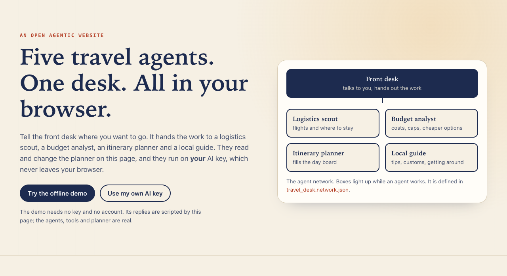

# Travel Desk

An open agentic website where **five AI travel agents plan your trip in your own browser, on your own AI key**.

- A **front desk** agent talks to you and hands out the work.
- A **logistics scout** estimates flights and picks where to stay.
- A **budget analyst** prices the trip, checks your cap and finds cheaper options.
- An **itinerary planner** fills the day-by-day board on the page.
- A **local guide** gives customs, getting-around tips and the best time to go.

The agents are one public JSON file. The open-source runtime runs them in the browser tab. They use the page's own functions as tools, so what they do shows up on the planner right away. There is no agent server, and the site never sees or pays for your AI key.

No key? Open the page with `?demo=1` for the **offline demo**. It is clearly labeled: the words are scripted by the page, but the five agents, their tools and the planner are real.



## Why

Trip planning is spread over many tabs: fares, rooms, maps, blogs, a budget sheet. AI travel assistants today live inside closed apps, run on the vendor's model, and keep your data. Travel Desk shows the other way, from the open agentic web spec:

- the agent team is **public data** anyone can read, copy or call;
- it runs **in the visitor's browser**, with the **visitor's own model and key**;
- it works **on the website itself**, through tools the site owns and limits;
- **other agentic websites can call it** by URL and run it for their own visitors.

## How it maps to the open agentic web spec

Spec: [cognizant-ai-labs/agentic-web](https://github.com/cognizant-ai-labs/agentic-web), MVP Profile 0.2.

| Spec requirement | In Travel Desk |
| --- | --- |
| Public `.json` agent network (§2, §3.3) | [`site/travel_desk.network.json`](site/travel_desk.network.json), built from [`site/travel_desk.hocon`](site/travel_desk.hocon) with the spec repo's own builder and validator |
| Manifest with `name`, `front_man`, `hocon` (§3.3) | [`site/agent-manifest.json`](site/agent-manifest.json): network `travel_desk`, front agent `front_desk` |
| Peer link map (§3.3) | [`site/links.json`](site/links.json) |
| Runtime that runs the network in the browser (§3) | [`site/runtime/`](site/runtime/), the spec repo's agentify-website runtime, copied unchanged |
| Interface to talk to the network | The chat in "Ask the travel desk", plus the live agent map in the hero |
| Interface to set LLM and key (§4, BYOK) | "AI model settings" in the chat. Key stays in this browser and goes only to the chosen provider. Delete it with "Delete setup" |
| Network interacts with the website | 7 site actions as `website_*` tools in [`site/site-actions.js`](site/site-actions.js): read the trip, read a guide, price a what-if, change details, add and remove board items, start a new trip |
| User approval before irreversible writes (§3.1, §5) | `start_new_trip` is `irreversible`; the page shows its own dialog with the real details before it runs, and refuses stale versions |
| Callable by other agentic websites (§3.2) | Network URL is `<site>/travel_desk`. The build writes [`site/bridge/`](site/bridge/) and discovery files in `site/.well-known/`. GitHub Pages sends `Access-Control-Allow-Origin: *` |
| Fail closed, bounded execution | `max_steps` 12 per agent, schema-checked arguments, `ok: false` refusals, peer policy `closed` |

Every agent takes one `request` string, as the spec's runtime expects. Shared rules (grounding, peer rules, CRUSE rules) come from the spec skill's template unchanged.

## Run it locally

Needs Node.js 22 or newer.

```shell
npm install          # only for the linter
npm run serve        # serves site/ on http://127.0.0.1:8080 with CORS headers
```

Open http://127.0.0.1:8080/?demo=1 for the offline demo, or http://127.0.0.1:8080/ and add your key in **AI model settings**.

- Default provider: hosted Otari (`https://api.otari.ai/api/v1`) with `alibaba/qwen-3.5-35b-a3b`.
- Other providers: pick one in the settings panel (OpenAI, OpenRouter, Groq, Google and more). The provider must allow browser calls (CORS) and the model must support tool calls.
- On `127.0.0.1` the runtime also keeps the key in a local cookie. Use a key with a low spending limit, then press **Delete setup** and close the tab when done.

## Check it

```shell
npm run check   # the network JSON and discovery files match the HOCON and manifest
npm run lint    # ESLint on this project's own code
npm test        # 38 tests: trip math, page + runtime integration, demo mode, key handling
npm run verify  # all three
```

After editing `site/travel_desk.hocon` or `site/agent-manifest.json`, run `npm run build`.

## Files

```text
site/                       the website (this folder is what GitHub Pages serves)
  index.html, styles.css    the page
  js/destinations.js        the site's own guide data: 8 destinations, cost bands, fare tiers
  js/trip-math.js           budget math, itinerary merging, date and input checks (pure)
  js/trip-desk.js           the page object App.page: the form, the board, the budget
  site-actions.js           the 7 website_* tools, wrapping App.page
  site.js                   boots the runtime; confirmation dialog; agent map; demo switch
  demo/demo-model.js        the offline demo model (scripted words, no network)
  travel_desk.hocon         the agent network source
  travel_desk.network.json  the published network (generated)
  agent-manifest.json       the public manifest
  links.json, agent-mcp.json, .well-known/, bridge/   public bundle files (partly generated)
  runtime/                  the open agentic web browser runtime (Apache 2.0, unchanged)
tests/                      Node tests (node:test), no browser and no LLM needed
tools/agentify-website/     the spec repo's build, serve and partner-check scripts (Apache 2.0)
.github/workflows/pages.yml checks, then publishes site/ to GitHub Pages
```

## What the agents can and cannot do

They can: plan days from the guide, price the trip and what-ifs, compare against a cap, suggest cheaper options, give flight and lodging bands, suggest neighborhoods, share customs and transport tips, change trip details, and start a new trip after you confirm.

They cannot: search live fares or rooms, book, take payment, check visas or track prices. They say so plainly. All amounts are rough 2026 planning bands compiled for this site, not quotes.

## Privacy

- Your messages and the planner data the agents read go to the AI provider **you** choose. Nothing goes to Travel Desk: it is a static site.
- Your key is saved in this browser's storage for this site only. It is never put in URLs, prompts, tool arguments or the network file. A test checks this.
- The offline demo makes no network requests at all. A test checks this too.
- The trip is saved in this browser's `localStorage` so it survives a reload.

## Other agentic websites calling Travel Desk

Use the network URL `https://<your-site>/travel_desk` as a tool in your network and list Travel Desk's origin in your `allowed_peers`. Your visitor approves the call on a consent card, and the network runs in their browser on their key. Callers get advice from the guide, not access to this page's planner.

## Known limits

- Static hosting only: no server, so no live prices and no bookings.
- The runtime runs `write` tools (board changes) without a dialog; only `start_new_trip` asks first. Board changes are easy to undo on the page.
- GitHub Pages cannot set custom headers. `runtime/sandbox-worker.js` would want a CSP header, but this site has no coded tools, so the sandbox is never used.
- The default model must support tool calls. Small models may skip delegation.

## License

MIT, see [LICENSE](LICENSE). Third-party parts (the runtime and build tools from the agentic-web repo) are Apache 2.0; see [NOTICE](NOTICE).
